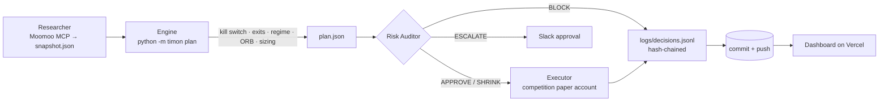
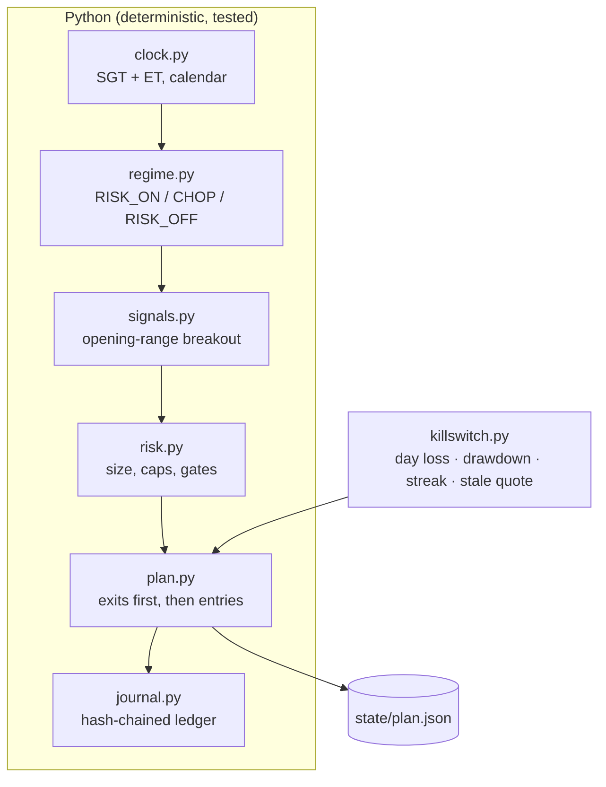

<p align="center">
  
</p>

<p align="center">


</p>

<h3 align="center">Every decision is a commit.<br>Every rule change is a diff.</h3>

**Timón is a paper-trading agent team where the language models gather facts and the arithmetic decides.** A researcher reads the market through Moomoo's MCP, a deterministic Python engine turns that snapshot into a plan, a risk auditor that can only tighten the plan gates it, and an executor places the orders. Every run ends as a git commit and a hash-chained ledger entry, so every position can be blamed back to the reason it was opened.

> **Status (17 Nov 2026): engine and dashboard ready, nothing has traded.** The engine, the risk gate, the kill switch and the ledger are built and covered by 43 tests; the Moomoo connector is verified against a live quote; the read-only Slack bot answers `status`; the dashboard renders the ledger and is ready to deploy. Not built yet: the competition account is unconfirmed, so the account guard blocks every proposal; Qoder Cloud Agents deployment, Slack approvals and the schedule are pending. No order has been placed.

---

## The 30-second version

| | |
|---|---|
| **What** | An AI agent team that paper-trades US ETFs, with a deterministic Python risk engine holding the veto |
| **Where** | Moomoo competition paper account, US market, $100k notional start |
| **Strategy** | Regime-filtered opening-range breakout: the first 30 minutes define the range, a close outside it is the signal. Long only, flat by 15:50 ET every day |
| **Universe** | SPY, QQQ, IWM, XLK, XLF, XLE, XLV, XLY, SMH |
| **Regime** | RISK_ON (SPY above SMA20 above SMA50, VIX below 25, breadth ≥ 50%), RISK_OFF (SPY below SMA50 or VIX ≥ 25), else CHOP at half size. Missing data is CHOP, never a guess |
| **The rule** | The model may describe the market. It may not size a position, choose a verdict or cancel a stop. Those are Python functions with tests |
| **Risk** | 0.5% of equity between entry and stop · 20% notional cap · a 3× gap costs at most 1.5% · gross exposure 80/30/20% by regime · 4 entries and 20 orders a day |
| **Kill switch** | −1.5% on the day halts new orders · −4% from peak flattens and disables the executor · 4 losses halve size · a quote older than 120 s means hold · a missed check flattens first |
| **Autonomy** | Earned, not assumed. Stage 1 sends every order to a human; stage 2 auto-approves ≤ 0.25% risk; stage 3 trades inside the limits. It is at **stage 1** |
| **Audit trail** | `logs/decisions.jsonl` is append-only and hash-chained (`python -m timon verify`); each run is a commit |
| **Honest scope** | Algorithmic paper trading for a competition. Not investment advice, not a live-trading product |

## Why it exists

The Moomoo x Qoder challenge asks for an agent that trades. The interesting part is not the trading, it is the accountability: an agent that cannot explain a position is a liability, and an agent that can rewrite its own risk limits is worse. Timón is built around that. Strategy and limits are files, changes to them are diffs, decisions are ledger entries, and the code that decides is small enough to read. If the equity curve is bad, the log says exactly which rule was wrong.

## How a cycle runs



| Stage | Owns | Never does |
|---|---|---|
| Researcher | Builds `state/snapshot.json` from Moomoo quotes, bars, regime inputs | Place, modify or cancel an order; invent missing data |
| Engine (`timon/`) | Session and calendar, regime, opening range, sizing, exits, kill switch | Take input from an LLM at decision time |
| Risk Auditor | Runs the engine, may tighten a verdict with a written reason | Loosen a verdict, hold broker credentials |
| Executor | Acts only on `plan.json`; exits first, then entries, then 2R targets | Originate a trade, increase size, widen a stop |
| Ledger | Appends every order, fill, close, note and error, chained | Allow an edit to a past entry |
| Slack | Escalations in stage 1, daily report | Approve its own escalation |

## How it works



| Module | Responsibility |
|---|---|
| `timon/clock.py` | Sessions, trading days, half days, the 15:50 ET flatten, the final competition flatten |
| `timon/regime.py` | RISK_ON / CHOP / RISK_OFF from SMA20, SMA50, VIX and breadth; missing data falls back to CHOP |
| `timon/signals.py` | Opening range over the first 30 minutes, breakout and invalidation rules |
| `timon/risk.py` | Position size from risk per trade, notional and gap caps, gross exposure, entry and order budgets |
| `timon/killswitch.py` | Daily loss halt, drawdown flatten, loss streak, stale quote, missed check |
| `timon/plan.py` | Orders exits before entries, attaches the 2R limit target, writes the plan |
| `timon/journal.py` | Append-only ledger with a hash chain, plus `verify` |
| `timon/cli.py` | `session`, `plan`, `killswitch`, `log`, `verify`, `metrics` |

The fill model is deliberately plain: paper prices are live Moomoo prices, a resting 2R limit is the only resting order the API supports, and stops are checked on every cycle because the paper API has no resting stop. An alert is not a stop order, so a missed cycle flattens rather than hoping.

## Risk limits

All of these live in `config/risk_limits.yaml` and are enforced in code, not in a prompt.

| Limit | Value |
|---|---|
| Risk per trade | 0.5% of equity, entry to stop |
| Position notional cap | 20% of equity |
| Gap rule | sized so a 3× stop gap loses at most 1.5% |
| Gross exposure | 80% RISK_ON · 30% RISK_OFF · 20% CHOP (CHOP also trades half size) |
| New entries per day | 4, none after 13:00 ET |
| Orders per day | 20 (competition cap is 200) |
| Stop | 1× ATR, checked every cycle |
| Target | 2R, placed as a resting limit |
| Flatten | 15:50 ET daily, hard flatten at the competition close |
| Daily loss halt | −1.5% |
| Drawdown | −4% from peak flattens and disables the executor |
| Loss streak | 4 losses halve size |
| Stale data | quote older than 120 s → hold; check gap over 12 min while holding → flatten |
| Universe guard | price ≥ $1, market cap ≥ $500M, average volume ≥ 1M |

## Results

| Check | Result | How to run |
|---|---|---|
| Engine test suite | **43/43 passing** | `python -m pytest -q` |
| Editable install | works | `pip install -e ".[dev]"` |
| Ledger integrity | hash chain verifies | `python -m timon verify` |
| Session clock | CLOSED outside US hours, correct ET and SGT times | `python -m timon session` |
| Moomoo MCP, live quote | US.AAPL 352.78, previous close 356.27 (data date 2026-11-16) | `quote_stock_quote` in Qoder |
| Moomoo paper accounts | account list reads (7 accounts, US `5822597`) | `sim_trade_account_list` |
| Trading-scope reads | **blocked**: connector authorised for market data only | `sim_trade_cash_info` |
| First paper trade | **not placed** — the account guard blocks while `competition_account_id` is empty | `python -m timon plan` |
| Qoder Cloud Agents, schedule, dashboard deploy | **pending** | — |
| Dashboard build | **verified locally**, desktop + 375/320 px | `python3 scripts/export_dashboard.py` then open `dashboard/index.html` |

A test suite passing is evidence about arithmetic, not about a strategy. None of this has been evaluated out of sample, because it has not traded yet.

## Run it

```bash
python3 -m venv .venv && .venv/bin/pip install -e ".[dev]"
.venv/bin/python -m pytest -q                       # 43 tests
.venv/bin/python examples/make_snapshot.py > examples/snapshot.json
.venv/bin/python -m timon session                   # SGT + ET, can_enter, must_flatten
.venv/bin/python -m timon plan examples/snapshot.json --no-log
.venv/bin/python -m timon verify                    # ledger integrity
.venv/bin/python -m timon metrics                   # trades, win rate, expectancy, average R, Sharpe
python3 scripts/package_skills.py                   # dist/*.zip for Cloud Agents upload
```

With an empty `competition_account_id` in `config/account.yaml` every proposal comes back BLOCKED. That is the point: the system fails closed until the competition account is confirmed and a test round trip has been done somewhere harmless.

## Dashboard

`dashboard/` is a static site: HTML, one CSS file, one ES module, and a hand-rolled SVG chart. No build step, no npm, no framework, no broker credentials in the browser. It reads one file, `dashboard/data.json`, which is generated from the repo:

```bash
.venv/bin/python scripts/export_dashboard.py                     # ledger + state → dashboard/data.json
.venv/bin/python scripts/export_dashboard.py --snapshot state/snapshot.json
python3 -m http.server 8000 -d dashboard                         # → http://localhost:8000
```

The export needs `pyyaml`, which the project venv already has (the macOS system `python3` does not).

The export computes the equity curve from closed-trade P&L in `logs/decisions.jsonl`, reads the kill-switch state and the current plan, and writes nothing back into `state/` or `logs/`. Empty ledger in, honest empty states out.

Deploying is one command against a static directory. `vercel.json` points `outputDirectory` at `dashboard/` and marks `data.json` no-cache so a fresh export is never stale:

```bash
vercel login
vercel --prod
```

The refresh path is git: the executor commits a run, CI or a scheduled export regenerates `data.json`, Vercel redeploys. The page also carries a Refresh button for the local case.

## Layout

```
timon/            engine: clock, indicators, regime, signals, risk, killswitch, journal, plan, cli
config/           risk_limits.yaml · calendar.yaml · account.yaml
skills/           coordinator · researcher · risk-auditor · executor, one SKILL.md each
state/            state.json (persistent), snapshot.json + plan.json (per run)
logs/             decisions.jsonl — append-only, hash-chained
examples/         synthetic snapshot generator and sample
scripts/          export_dashboard.py (repo → dashboard/data.json) · package_skills.py
tests/            pytest suite
dashboard/        static dashboard: index.html · styles.css · app.js · data.json (generated)
docs/brand/       logo
```

## Documentation

| Document | What's in it |
|---|---|
| [TIMON.md](TIMON.md) | The full plan: scoring, rules, timeline, strategy, architecture, journal schema, submission package |
| [AGENTS.md](AGENTS.md) | System prompt, skills, model tier and version lock for each of the four Cloud Agents |
| [HANDOFF.md](HANDOFF.md) | Source of truth for a session: status, decisions, risk limits, next steps, environment facts, log |
| [config/risk_limits.yaml](config/risk_limits.yaml) | Every limit the engine enforces, with the reason for each in comments |
| [docs/brand/timon-logo-horizontal.svg](docs/brand/timon-logo-horizontal.svg) | The mark: a helm |

## The name

Timón is Spanish for the helm, the wheel that steers. Nothing in the system makes a judgement call but the engine, and nothing moves the account but the executor: the name is where the responsibility sits.

## Paper trading only

Timón trades a competition simulation account. It never touches a live account, it holds no funds, and it is not investment advice. The strategy is a well-known textbook breakout, chosen because it is easy to audit, not because it is profitable.
