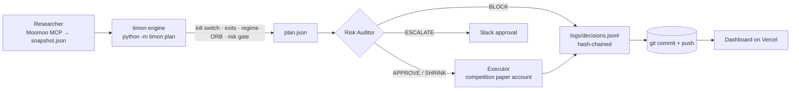

# Timón — git for trading

An AI paper-trading agent team for the Moomoo x Qoder AI Trading Agent Challenge.
The AI proposes, a deterministic Risk Auditor decides, the kill switch always wins,
and every decision is a commit.

- Plan and rules: [TIMON.md](TIMON.md)
- Agent definitions and version lock: [AGENTS.md](AGENTS.md)
- Where things stand and what's next: [HANDOFF.md](HANDOFF.md)

## How it works



LLM agents fetch data and place orders. Every decision that matters — session,
regime, sizing, verdict, kill switch — is plain Python in `timon/`, covered by tests.

## Run it locally

```bash
pip install -e ".[dev]"
python -m pytest -q                              # 43 tests
python examples/make_snapshot.py > examples/snapshot.json
python -m timon session                          # current session, SGT + ET
python -m timon plan examples/snapshot.json --no-log
python -m timon verify                           # ledger integrity
python -m timon metrics                          # trades, win rate, expectancy, Sharpe
python scripts/package_skills.py                 # dist/*.zip for QCA upload
```

With an empty `competition_account_id` in `config/account.yaml`, every proposal is
BLOCKED. That is intentional: the system fails closed until the competition account
is confirmed.

## Layout

```
timon/            engine: clock, indicators, regime, signals, risk, killswitch, journal, plan, cli
config/           risk_limits.yaml · calendar.yaml · account.yaml
skills/           coordinator · researcher · risk-auditor · executor (SKILL.md each)
state/            state.json (persistent), snapshot.json + plan.json (per run)
logs/             decisions.jsonl — append-only, hash-chained ledger
examples/         synthetic snapshot generator
scripts/          package_skills.py
tests/            pytest suite
dashboard/        Vite + React app (to build)
```

Paper trading only. Not investment advice.
