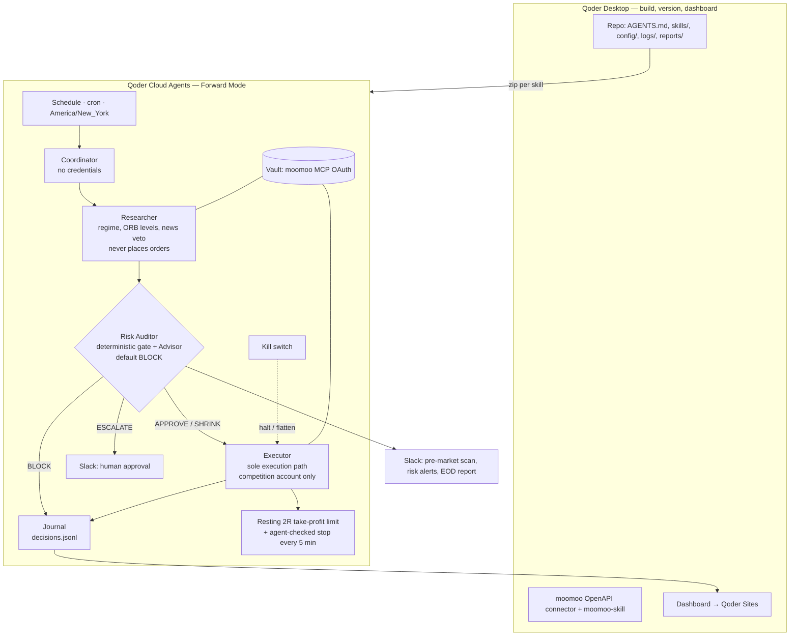

# Timón — Moomoo x Qoder AI Trading Agent Challenge

> Git for trading. The AI proposes, the Risk Auditor decides, the kill switch always wins, and every decision is a commit.

| Field | Value |
|---|---|
| Entrant | Aljabri Alam (individual entry) |
| Doc version | v0.1 — 17 Nov 2026 |
| Status | Planning: PRD not yet run in Qoder |
| Submission | 30 Nov 2026, 23:59 SGT |
| Finalists | 8 Dec 2026 (top 10 present) |

---

## 1. Scoring (provisional, may change)

| Criterion | Weight | What wins it |
|---|---|---|
| Risk-adjusted return | 25% | **Sharpe ratio**: smooth daily returns, few large swings |
| Qoder / QCA usage | 30% | Multi-agent orchestration, schedules, Slack channel, dashboard, reusable skills |
| Strategy & risk design | 30% | Clear thesis + edge, conditions that invalidate it, position limits, drawdown responses, kill switches |
| Reuse & documentation | 15% | Agent templates, skills, scripts, Qoder-generated deck/report |

What judges want to see (from the kickoff deck):
- [ ] A baseline to compare against
- [ ] Tuning kept separate from evaluation (out-of-sample)
- [ ] Costs and partial fills modelled
- [ ] Decision logs that include rejected and failed decisions
- [ ] Instructions to reproduce or re-run the work
- [ ] An honest demo: what worked, what failed, and why

---

## 2. Competition rules (from the T&Cs)

| Rule | Value |
|---|---|
| Account | Dedicated competition paper account only (Discover → Paper Trade → Competition). Cannot be reset. Reset cards = disqualification |
| Starting balance | US$100,000 |
| Universe | US-listed stocks, ETFs, options only. Price ≥ $1, market cap ≥ $500M |
| Sessions (SGT) | Pre 17:00–22:30 · Regular 22:30–05:00 · After 05:00–09:00 |
| Order cap | 200 executed orders/day |
| Positions cap | 100 |
| Single-stock cap | 40% of total assets |
| Margin | Long 50% initial / 40% maintenance · Short 60% / 50% |
| Interest | 4.8% p.a. margin, 6.0% p.a. short, charged daily after the close |
| Fills | Volume-matched. If market volume × 20 < order qty, the order may fill only partially |
| Stock fees | $0 commission + $0.99 platform fee/order + $0.000166/share sold (cap $8.30) |
| Settlement | Regular-market close on the final day. After-hours trades on the final day are not counted |
| Options | ITM options auto-exercise at expiry. Close before expiry to avoid share delivery |

Safety rules for setup:
- During Moomoo OAuth, grant **Market Data (+ Watchlists) only**. Leave **Accounts & Orders** and **Trade Execution** unticked. Paper trading still works.
- Do the test trade in a **non-competition** paper account first.
- Store the competition account ID in config and assert it on every order.

---

## 3. Timeline

| Date (SGT) | Market | Plan |
|---|---|---|
| Mon 16 Nov | Setup | Kickoff (done) |
| Tue 17 Nov | Full day | Setup, connectors, PRD, test trade in a non-competition account |
| Wed 18 Nov | Full day | Vault + skills + 2-agent loop live; first competition trade. Meta VR deadline is the same day, so keep this minimal |
| Thu 19 – Fri 20 Nov | Full days | **Stage 1: human approves every order.** Tuning window |
| Mon 23 – Tue 24 Nov | Full days | **Stage 2: small orders automatic.** Config frozen from 23 Nov |
| Wed 25 Nov | Full day | **Stage 3: fully automatic within limits.** Out-of-sample evaluation |
| Thu 26 Nov | **Closed** (Thanksgiving) | Audit logs, fix bugs |
| Fri 27 Nov | **Half day**, regular 22:30–02:00 | Flat by **01:45 SGT Sat 28 Nov** |
| Sat 28 – Sun 29 Nov | Closed | Report, deck, demo video, package |
| Mon 30 Nov | — | Submit by 23:59 SGT |

---

## 4. Strategy

### Thesis
Intraday opening-range breakout (ORB) on liquid ETFs, **filtered by daily market regime** and **vetoed on event risk**. Positions are closed by the US close every day: no overnight gaps, no margin interest, no holiday risk.

### Edge hypothesis
A plain ORB takes trades against the broader trend and into news events. Restricting it to the regime's direction and skipping event-risk days should improve expectancy and lower volatility, which raises Sharpe.

### Universe
SPY, QQQ, IWM + the top 2–3 sector ETFs by relative strength (XLK, XLF, XLE, XLV, XLY, SMH). Single stocks only if the regime is RISK_ON and liquidity checks pass.

### Rules
| Step | Rule |
|---|---|
| Regime (pre-market) | RISK_ON / RISK_OFF / CHOP from SPY vs 20/50 SMA, VIX level, sector breadth |
| Opening range | High/low of 9:30–10:00 ET (22:30–23:00 SGT) |
| Entry | Long on a breakout above the range high in RISK_ON. Short or skip below the range low in RISK_OFF. CHOP: no trade, or half size |
| Veto | Researcher blocks on earnings, macro release, or news risk for that symbol/sector |
| Stop | Opposite side of the range or 1 × ATR, whichever is tighter. **Mental stop checked by the agent every 5 min**: the paper API supports limit and market orders only, with no resting stop orders. A breach is closed with an aggressive limit, escalating to market if unfilled after one check |
| Target / exit | Resting **limit** take-profit at 2R placed right after the fill (DAY order); time exit at 15:50 ET (04:50 SGT) |
| Orders | Limit orders; ladder +$0.01–0.10 toward the ask, never above it |

### Invalidation (stop trading the strategy if any of these happen)
- Expectancy below 0 after 15 trades
- Regime label flips twice within one session
- Realized intraday volatility above its cap (VIX > threshold)
- 3 losing days in a row

### Baselines (logged, not traded)
1. SPY buy-and-hold over the same window
2. **Shadow ORB**: same rules without the regime filter or veto

---

## 5. Risk limits (enforced in code, not prompts)

`config/risk_limits.yaml`

| Control | Limit | Response |
|---|---|---|
| Risk per trade | 0.5% of equity | Shares = risk $ / stop distance |
| Position notional | ≤ 20% of equity | SHRINK |
| Gross exposure | 80% RISK_ON · 30% RISK_OFF · 20% CHOP | SHRINK / BLOCK |
| Distinct tickers | ≥ 3 if holding more than 1 position | BLOCK |
| Orders/day | ≤ 20 (platform cap 200) | BLOCK |
| Daily loss | −1.5% | Halt new orders for the day |
| Total drawdown | −4% from peak | Flatten everything, disable the Executor |
| Loss streak | 4 consecutive losses | Halve size |
| Data health | Stale quote or MCP error | HOLD, no new orders |
| Account guard | Account ID ≠ competition ID | Refuse the order |
| Session guard | Outside regular hours | BLOCK |
| Holiday guard | After 01:45 SGT Sat 28 Nov | Flatten, disable |
| End of day | 15:50 ET | Close all positions |
| Stop monitor | Missed or skipped check while holding a position | Next run flattens first, then reports. No new entries until 2 clean checks |
| Max hold size | Size so a 3 × stop gap loss ≤ 1.5% equity | Covers the gap between 5-min checks |

---

## 6. Agent architecture (QCA Forward Mode)



| Agent | Role | Credentials | Model |
|---|---|---|---|
| Coordinator | Runs on schedule, delegates, collects results | None | Mid |
| Researcher | Regime, opening range, news/sentiment/earnings veto. Never places orders | Vault (read) | Mid |
| Risk Auditor | Deterministic rule gate; Advisor for second opinion. Runs in its own session thread | None | Strong |
| Executor | Places and protects orders in the competition account. Never originates trades | Vault | Light |

Rules:
- The Executor never acts on Researcher output without an Auditor APPROVE or SHRINK.
- Lock each child agent to a specific version, never `latest`.
- File ownership: Researcher → `state/research/`, Auditor → `state/verdicts/`, Executor → `state/orders/`, Journal → `logs/`.
- Day 1: start with 2 agents (Researcher+Auditor logic, Executor). Split into 4 once the loop is proven.

### Messaging channel
- **Slack** is the live channel: it's built into QCA Templates (Channels tab) and counts toward the automation score.
- Telegram is not a built-in QCA channel, so it's out of scope for this build.
- Pitch line: *"Channel-agnostic: the same agent output can go to Slack, Teams, Lark, DingTalk, WeCom or WeChat with a config change, and to Telegram/WhatsApp through a webhook adapter."*

### Schedule (America/New_York, Mon–Fri, competition window only)
| Time ET | SGT | Run |
|---|---|---|
| 09:00 | 22:00 | Pre-market: regime label, watchlist, event calendar → Slack |
| 10:00 | 23:00 | Opening range set; evaluate entries |
| 10:05–15:45, every 5 min | 23:05–04:45 | Stop checks and position management; new entries until 13:00 ET. Runs must finish in under 5 min (concurrency 1: overlapping runs are skipped) |
| 15:50 | 04:50 | Close all positions |
| 16:05 | 05:05 | EOD report → Slack + journal |

### Earned autonomy
| Stage | Dates | Authority | Promotion evidence |
|---|---|---|---|
| 1 Human review | 18–20 Nov | Every order approved in Slack | 5+ clean cycles, all guards tested |
| 2 Bounded | 23–24 Nov | Orders ≤ 0.25% risk automatic; rest escalate | No limit breaches, fills reconciled |
| 3 Proven | 25–27 Nov | Fully automatic inside limits | — |

---

## 6b. Tech stack and "git for trading" ledger

| Layer | Tech |
|---|---|
| Build | Qoder Desktop (required) |
| Run | Qoder Cloud Agents, Forward Mode (required). Container: Ubuntu 22.04, Python 3.12, Node 20, git |
| Broker | Moomoo MCP `https://mcp.moomoo.com/mcp` + moomoo-skill, OAuth in QCA Vault |
| Agent logic | SKILL.md + Python 3.12 (pandas, numpy, pyyaml) |
| Rules | YAML config: `risk_limits.yaml`, `account.yaml`, `calendar.yaml` |
| Ledger | Git + GitHub repo, attached to sessions as a `github_repository` resource with a fine-grained PAT (Contents: Read & Write) |
| Messaging | Slack (QCA template channel, Socket Mode, Pairing mode) |
| Dashboard | React + TypeScript (Vite), motion.dev, TradingView Lightweight Charts |
| Hosting | **Vercel** (primary). Optional mirror on Qoder Sites for extra Qoder usage |
| Docs | Markdown + Mermaid; Qoder-generated deck |

**Git for trading:** every decision is a commit, every rule change is a diff, any position can be blamed back to its reason.

| Git | Timón |
|---|---|
| Commit | One per run: new lines in `decisions.jsonl`, account snapshot, state |
| Message | `BUY QQQ 120 @ 512.45: ORB break in RISK_ON, risk 0.5%` |
| Diff | Changes to `config/` and agent prompts between versions |
| Branch | `main` = live; `shadow-orb` = baseline without the regime filter |
| Tag | `stage-1-human`, `stage-2-bounded`, `stage-3-auto`, `config-frozen` |
| Blame / revert | Trace any position to its decision; roll back a bad rule change |

Repo layout:
```
timon/
├── AGENTS.md                 # agent prompts, models, locked versions
├── HANDOFF.md                # turnover doc: status, next steps, session log
├── timon/                    # deterministic engine (python -m timon ...)
├── TIMON.md                  # this file
├── skills/                   # one folder per skill → zipped for QCA
│   ├── timon-coordinator/
│   ├── timon-researcher/
│   ├── timon-risk-auditor/
│   └── timon-executor/
├── config/                   # risk_limits.yaml, account.yaml, calendar.yaml
├── state/                    # positions, open orders, last check time
├── logs/decisions.jsonl      # append-only decision ledger
├── snapshots/YYYY-MM-DD/     # account + fills per run (JSON)
├── reports/YYYY-MM-DD.md     # daily report
└── dashboard/                # Vite app, deployed to Vercel
```

Data flow: agents → commit to GitHub → Vercel dashboard reads the repo (read-only). The dashboard never holds Moomoo credentials. If it shows QCA agent status, the Qoder PAT stays in a Vercel serverless function env var, never client-side.

Notes:
- Container storage is ephemeral: push at the end of **every** run.
- Each scheduled run starts a new session. Instructions must be self-contained; state comes from the repo.
- Create the schedule from the Slack conversation so results post there. API-created schedules need `sinks` for IM delivery.

---

## 7. Journal schema

`logs/decisions.jsonl`, one line per decision, rejections included.

```json
{
  "ts": "2026-11-19T23:05:12+08:00",
  "session": "RTH",
  "regime": "RISK_ON",
  "symbol": "QQQ",
  "proposal": {"side": "BUY", "entry": 512.40, "stop": 509.80, "target": 517.60, "risk_pct": 0.5},
  "evidence": ["ORB high 512.30 broken on 1.4x vol", "no earnings/macro flags"],
  "verdict": "APPROVE",
  "verdict_reason": "within limits; gross 22%",
  "order_id": "3235887",
  "status": "FILLED",
  "fill_price": 512.45,
  "fees": 0.99,
  "stop_order_id": "3235888",
  "r_multiple": null,
  "agent_versions": {"researcher": 3, "auditor": 2, "executor": 2}
}
```

Daily report (`reports/YYYY-MM-DD.md`): P&L, Sharpe to date, max drawdown, trades, win%, average R, expectancy, blocks by reason, shadow-ORB comparison.

---

## 8. Setup checklist

- [ ] Qoder account on the Luma email; Pro plan confirmed (Settings → My Billing)
- [ ] 2,000 Pro credits in use; claim 1,500 top-up at claims.sg-cloudace.com **after** the 2,000 run out
- [ ] Competition account visible in the moomoo app (rollout from 17 Nov 11:00 SGT)
- [ ] Qoder Desktop: moomoo OpenAPI connector installed (Market Data only)
- [ ] Qoder Desktop: moomoo-skill installed
- [ ] Qoder Desktop: Qoder Cloud Agents plugin installed
- [ ] Read-only check: "What is the current price of US.AAPL?"
- [ ] "List my paper trading accounts…" → competition account ID saved to `config/account.yaml`
- [ ] Test trade + close in a **non-competition** paper account
- [ ] QCA Vault `moomoo-mcp` with MCP OAuth to `https://mcp.moomoo.com/mcp`
- [ ] Skills zipped (one per skill) and uploaded to QCA
- [ ] Template + agents created, versions locked, AGENTS.md exported locally
- [ ] Slack bot on the template (Pairing mode)
- [ ] Schedule created (America/New_York, ends 27 Nov 13:00 ET)
- [ ] Dashboard running locally with server-side PAT in `.env` (gitignored)

---

## 9. Prompts

### 9.1 PRD (paste into Qoder Desktop)
```
Help me create a PRD for my Moomoo × Qoder AI Trading Agent Challenge entry, "Timón", using TIMON.md in this repo as the source of truth. US-only paper trading, agents in QCA Forward Mode, connected to the Moomoo MCP (via Vault) and moomoo-skill.
Work in three rounds — Goal, Rules, Prove it works — and ask me clarifying questions each round before finalising. Then propose the QCA template for each agent and an AGENTS.md with locked versions. Do not place any orders.
```

### 9.2 Account check
```
List my paper trading accounts and confirm you can access the Qoder AI Agent Trading Challenge account. Show each account ID and name. Do not place any orders.
```

### 9.3 Dashboard
```
Create a dashboard for my Moomoo × Qoder challenge agents. Use Moomoo integration for paper-account positions, orders and P&L, and QCA agent status, decisions and logs from logs/decisions.jsonl. Show equity curve vs SPY and the shadow ORB baseline, drawdown, Sharpe to date, expectancy, and blocked decisions by reason. Keep the QCA PAT server-side in .env. Follow Apple HIG, no emojis. Run it locally.
```

### 9.4 Schedule
```
Please create a scheduled task named "Timón Session".
Run Monday–Friday at 09:00, 10:00, every 5 minutes from 10:05 to 15:45, at 15:50 and 16:05, America/New_York.
Each run must be self-contained: pull the timon repo, read state/ and config/, act, append to logs/decisions.jsonl, commit and push before finishing.
Only between 2026-11-18 and 2026-11-27 13:00 America/New_York; skip 2026-11-26.
Run the Timón Coordinator per TIMON.md section 6 and post a concise summary to Slack.
After creation, confirm the task ID, rule, time zone and next run time.
```

### 9.5 Troubleshooting
```
Help me troubleshoot my QCA trading agent. Goal: [what I want]. Error: [exact message]. Context: [setup and steps tried]. Suggest checks and a safe fix; ask for missing details.
```

---

## 10. Submission package

- [ ] Qoder-generated deck (strategy, risk limits, architecture, results, what failed and why)
- [ ] Runnable package: `skills/`, `config/`, `AGENTS.md`, `README.md` with re-run steps
- [ ] `logs/decisions.jsonl` + fills + daily reports
- [ ] Dashboard screenshots or recording
- [ ] Demo video: ~1/3 showing the system refusing or stopping safely (kill switch, BLOCKs, wrong-account refusal)

---

## 11. Open questions

- [x] ~~Stop orders via API?~~ No: the paper API supports limit and market only (per the trading-playbook reference). Stops are agent-checked; see section 4
- [ ] Confirm with the MCP itself: "What order types can I place on the paper account?"
- [ ] Which MCP tool returns the paper account list and IDs?
- [ ] VIX and breadth data source via Moomoo MCP, or a second MCP?
- [ ] Short side in RISK_OFF, or skip and stay flat?

---

## 12. References

- Challenge site (Handbook, FAQ, T&Cs): https://moomoo-qoder-challenge-rgkelnyuzbm.qoder.website/
- Qoder kickoff deck: https://ngynckpj.qwenwork.page/
- Moomoo strategy briefing: https://moomoo-strategy-briefing-j692pppjg7l.qoder.website/
- Forward Mode guide: https://kgcedzh3.qwenwork.page/
- Order types: https://moomoo-order-types-j692pppjg7l.qoder.website
- Example dashboards: https://challenge-dashboard-j692pppjg7l.qoder.website/ · https://trading-playbook-j692pppjg7l.qoder.website/
- QCA docs: https://docs.qoder.com/cloud-agents/overview · multi-agent: https://docs.qoder.com/cloud-agents/multi-agents
- Moomoo MCP: https://open.moomoo.com/mcp-docs/overview
- Moomoo skills: https://github.com/MoomooOpen/moomoo-agent-hub

---

## Changelog

| Date | Version | Change |
|---|---|---|
| 2026-11-17 | v0.1 | Initial plan from challenge site, kickoff deck and strategy briefing |
| 2026-11-17 | v0.2 | Slack as live channel; Telegram out of scope, mentioned as possible via adapter |
| 2026-11-17 | v0.3 | Tech stack + git ledger; Vercel hosting; stops are agent-checked (no API stop orders); 5-min checks; trading-playbook and container findings |
| 2026-11-17 | v0.4 | Engine, tests, skills, AGENTS.md, HANDOFF.md built; gap cap 1.5%; journal folded into engine (executor logs via CLI) |
